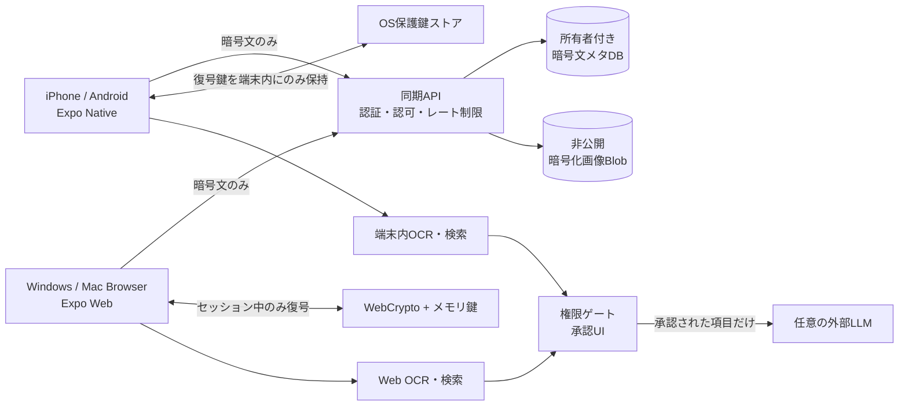

# アーキテクチャ・Windows実装計画 v1.1

## 目的と範囲

iPhoneで撮影・データ化 → 暗号文同期 → Windows PCで一括整理 → iPhoneに反映。Androidも同じ操作系を提供。名刺画像と文字情報をサーバー管理者が復号できないことを狙う。ただし**鍵を扱う端末の侵害やユーザー承認後の外部LLM送信までE2EEは防げない**。

## 採用スタック

| レイヤ | 技術 | 留意点 |
|---|---|---|
| iPhone/Android/Web UI | Expo Router + React Native + React Native Web + TypeScript | 単一リポジトリ、共通ドメイン・画面コンポーネント。テーブル等はレスポンシブ調整 |
| Nativeカメラ/OCR | Expo Camera + ネイティブML Kit日本語OCRアダプタ | ML Kit連携はExpo Goではなく開発ビルド。実装前に日本語モデル/SDK互換性を検証 |
| PC取り込み | 画像/PDFインポート + ローカルOCR候補（実装前に選定/評価） | PCはネイティブML Kitに依存しない。ブラウザでOCR処理できない場合は手入力にフォールバック。PDFページ枚数・サイズを制限 |
| NativeローカルDB | expo-sqlite + SQLCipher | `useSQLCipher:true` と開発ビルド。鍵はSecureStoreなどのOS保護領域を利用。PRAGMA keyの取り扱いと新規接続を要検証 |
| WebローカルDB | IndexedDB + AES-GCMで暗号化済みBlob保存 | WebにSQLCipherは使わない。復号検索用データはメモリ上に保持し、ロック/ページ破棄で消去。XSS対策が非常に重要 |
| クロスプラットフォーム暗号 | `expo-crypto` AES-GCM + ラッパー/テストベクトル | 暗号文フォーマット/nonce/AADの整合性をiOS ↔ Webで検証。鍵導出には監査されたKDFを採用 |
| クラウド同期 | HTTPS認証API + PostgreSQLメタデータ + 非公開オブジェクトストレージ | サーバーは暗号文のみ。実装効率重視ならBaaSでも可。AuthZ/全件取得制限/レート制限必須 |
| 認証 | メールOTP/パスキー等の既存認証サービス | **アカウント認証とデータ復号鍵を分離**。認証できても復旧鍵なしで平文閲覧は不可 |
| AI | 端末内検索/ローカルルール + 任意の外部LLM | 最小限の項目を承認画面で確認。APIキーをアプリ/Webへ埋め込まない。サーバー代理呼び出しにAuthZ+短期承認を必須化 |
| iOS署名/ビルド | EAS Build クラウド | WindowsからiOS .ipa作成可能。iPhoneへの開発ビルドインストールにはApple Developer Program等が必要 |
| PC配布 | HTTPS Web版 | デスクトップ版インストール不要。PWAは任意。画面幅1280/960/390pxを重点試験 |

## 構成図



## 鍵管理・同期プロトコル（暗号仕様の概念設計）

1. 初回登録: CSPRNGで32バイトのVault Master Key(VMK)を生成。個別レコード/画像の鍵はHKDFなど仕様固定の手段で用途別に導出し、AES-256-GCMで暗号化。全レコードで**nonce重複禁止**（12バイト乱数を使用する場合、再利用監視/上限設計）。
2. Cloudへは `{object_id,revision,type,ciphertext,nonce,key_version,deleted_at,content_hash}` のような構造化データを送る。`owner_id`と`object_id`など改ざん防止のAADを設定し、暗号化実装時に**署名の有無とAAD適用境界を検証**する。
3. iPhoneはVMK自体を平文保存しない。OSに保護されたデバイス鍵でVMKをラップし、必要に応じFace ID/端末認証で解除。生体情報変更・再インストール時は復旧フローを使う。
4. Webはユーザーが入力した高エントロピーの復旧キー、または明示承認の端末追加方式でVMKをアンラップ。**復号鍵をlocalStorage・Cookie・IndexedDBに平文保存しない**。XSS対策と短時間セッションロックを実装する。
5. クロス端末で同じVMKを回復するため、VMKを別個のランダム復旧キーでラップした`key_envelope`を保存。ユーザーが保管する復旧キーの検証入力を初期設定に含める。短い任意パスワードを直接暗号化鍵として使用しない。
6. 新端末で認証後、復旧キー等によりVMKを復元 → 必要な同期暗号文を取得 → 各端末内で復号/検証する。**認証だけで復号可能にはしない**。
7. 更新競合はオブジェクト単位のrevision/ETagで検出。勝手な上書き・名寄せは禁止。競合UIでユーザーに採用値を選ばせる。削除は`tombstone`で各端末へ伝播し、保持期間を明示する。
8. 同期イベントには正規化された名刺氏名、会社、メール、電話、OCR原文を一切含めない。サーバーログにもHTTP本文を記録しない。

**暗号・復旧は製品の中核となる高リスク実装**。自作アルゴリズムは使用しない。暗号APIとデバイス鍵周りはまずiPhone実機・Windowsブラウザ間で暗号テストベクトル/故障注入/復旧試験を行う。

## 単一Expo Routerリポジトリ例

```text
secure-card-agent/
├─ app/
│  ├─ _layout.tsx
│  ├─ (auth)/{welcome,sign-in,unlock,recover}.tsx
│  ├─ (tabs)/{index,people,scan,assistant,settings}.tsx
│  ├─ scan/{queue,review}.tsx
│  ├─ people/[id].tsx
│  ├─ duplicates/index.tsx
│  ├─ assistant/approve.tsx
│  ├─ settings/{sync,security,audit,export}.tsx
│  └─ sync/conflicts.tsx
├─ src/
│  ├─ components/{common,native,web}/
│  ├─ features/{capture,ocr,people,review,search,duplicates,ai,sync,security}/
│  ├─ domain/{entities,policies,validation}/
│  ├─ repositories/
│  │  ├─ contacts.repository.ts
│  │  ├─ database.native.ts       # SQLCipher
│  │  ├─ database.web.ts          # IndexedDB暗号化Blob
│  │  └─ search-index.web.ts      # 復号セッション中のメモリ
│  ├─ crypto/{vault,record-envelope,keys.native,keys.web}/
│  ├─ services/{auth,sync-api,audit}/
│  └─ design/{tokens,layout}/
├─ db/migrations/*.sql           # Native SQLCipher用
├─ db/server/*.sql               # Cloud同期用PostgreSQL
├─ tests/{unit,integration,e2e,security}/
├─ app.config.ts
├─ eas.json
└─ package.json
```

## Windowsセットアップ (PowerShell)

前提：Windows 11、Node.js公式LTS、Git、VS Code、Android Studio（Android確認する場合）。iOSビルドはApple署名アカウント + EAS Buildで実施する。

```powershell
node --version
npm --version
git --version
npx create-expo-app@latest secure-card-agent
cd secure-card-agent
npx expo install expo-router react-native-web react-dom expo-sqlite expo-secure-store expo-crypto expo-camera expo-file-system
npm install -D typescript
npm install -g eas-cli
eas login
# ブラウザのWeb画面プレビュー
npx expo start --web
# ネイティブ暗号化・ML Kitを組み込んだ後、EASでiPhone開発ビルドを作成
# 以下は署名設定後に実行
eas build --platform ios --profile development
```

**注意:** Expo SDKの最新版/モジュール互換表をインストール時に確認。OCRのML KitブリッジはそのSDKの新アーキテクチャ対応を検証するまで確定しない。iOSネイティブ開発ビルドではExpo Goでの試験結果を暗号化・OCRの根拠にしない。Web版はHTTPSで配信する。

## デバイス別機能マトリクス

| 機能 | iPhone | Android | PC Web |
|---|---|---|---|
| 名刺撮影 | カメラ・連続撮影 | カメラ・連続撮影 | ファイル取込優先、カメラは任意 |
| OCR | 端末内ML Kit | 端末内ML Kit | ブラウザ内OCRアダプタ / 手修正フォールバック |
| 登録・編集・検索 | 全対応 | 全対応 | 全対応、テーブル一括編集 |
| AIルール・候補 | 全対応 | 全対応 | 全対応 |
| 外部LLM | 事前承認 | 事前承認 | 事前承認 |
| 暗号化ローカルデータ | SQLCipher＋暗号化画像 | SQLCipher＋暗号化画像 | IndexedDB内の暗号文Blob・WebCrypto |
| オフライン | 対応 | 対応 | オフラインWebはブラウザ条件付き、試験後に保証 |
| 同期 | E2EE | E2EE | E2EE |
| Face ID/生体認証 | 対応 | 対応端末 | パスキー/復旧鍵など、OS条件による |

## 費用・可用性・運用負荷

| 選択肢 | コスト | 可用性 | 運用負荷 | 判断 |
|---|---|---|---|---|
| 完全ローカル | 最少 | 各端末単独 | 低いが復旧は自己責任 | マルチ端末要件を満たさない |
| E2EE + マネージドDB/ストレージ | 利用人数/容量/通信量に比例 | クラウド障害中もローカル操作可、同期は停止 | 中程度（認可・復旧・監査） | **MVP推奨** |
| E2EE + 自前VM/DB | 比較的小規模でも定額費用が発生 | 運用設計に依存 | 高い（パッチ/バックアップ/監視） | MVPには非推奨 |

初期はテスト用の暗号文データ・1アカウントで検証し、クラウド費用の公開価格を実装時点で算定する。正式な可用性/SLAは実測・採用プロバイダの契約条件によって決める。

## マイルストーン（相対日数：概算、開発者1名）

| フェーズ | 目安 | 完了条件 |
|---|---|---|
| 0. 技術リスク先行検証 | 3–5日 | iPhoneでSQLCipher/日本語OCR成功、WebCryptoと相互復号成功 |
| 1. UI/ローカル名刺帳 | 6–10日 | 15画面、50件連続取り込み/入力修正、検索、重複候補 |
| 2. E2EE同期・端末追加 | 8–14日 | iPhone ↔ PCで同期・競合・復旧・紛失試験合格 |
| 3. AI・操作承認 | 3–6日 | 検索/文案/外部送信承認/監査、未承認通信ゼロ |
| 4. セキュリティ・配布 | 5–8日 | iOS TestFlight/Web本番想定E2E、リリースゲート合格 |

上記は**計画見積もり**であり、SDKの互換性やiOS審査によって変動する。iOS/PC両立とE2EEをMVPに含めるため、旧モバイル単独案より工程が増える。

## 参考リンク

- https://docs.expo.dev/router/introduction/
- https://docs.expo.dev/versions/latest/sdk/sqlite/
- https://docs.expo.dev/versions/latest/sdk/crypto/
- https://docs.expo.dev/versions/latest/sdk/securestore/
- https://docs.expo.dev/tutorial/eas/ios-development-build-for-devices/
- https://docs.expo.dev/workflow/web/
- https://mas.owasp.org/MASVS/
