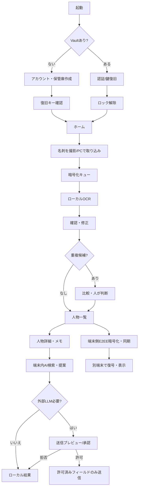

# iPhone / Android / PC UI・UX詳細仕様 v1.1

## 1. デザインコンセプト

**「受け取って、整理して、次につなぐ。」** 名刺管理は業務道具。必要な情報が読みやすく、1回の連続撮影で多数取り込めること、情報流出のリスクや未確認のOCRをユーザーが見分けられることを優先する。

- 色: 白 #FFFFFF / 背景 #F7F8FA / 文字 #172B44 / 主操作 #2156A5 / 境界 #DCE3EB / 注意 #9A5B17 / 危険 #A12A36。
- 文字: iOSはSF Pro系、Windows WebはSegoe UI系。標準サイズ16px、補足13px以上、重要値18px以上。
- アクセシビリティ: タップ領域最低44×44pt、キーボード操作、フォーカス表示、VoiceOver/スクリーンリーダーラベル、文字サイズ変更、色以外の状態表示。
- iPhoneは1列・下部ナビ。PCは左サイドバー＋一覧と詳細の2ペイン、キーボードショートカット（検索 `/`、新規取り込み `N` は入力欄操作中無効）。
- 永続的な「AIっぽい演出」は不要。提案には根拠と参照した名刺/メモを必ず表示。AI生成の情報を元名刺の事実として無断更新しない。
- **偽の安全表示をしない**。「暗号化済み」「同期完了」は実際の保護/通信状態を検証した場合だけ表示する。

## 2. グローバルナビ・ルート

| ID | 画面 | Expo Router | iPhone | PC |
|---|---|---|---|---|
| S00 | 利用開始 / アカウント認証 | `/(auth)/welcome`, `sign-in` | ステップ表示 | 中央狭幅 |
| S01 | 保管庫作成・復旧キー確認 | `/(auth)/recover` | 入力＋確認 | 狭幅フォーム |
| S02 | 保管庫ロック解除 | `/(auth)/unlock` | 生体認証・復旧キー | 復旧キー/パスキー |
| S03 | ホーム | `/(tabs)/index` | カード積み上げ | 概要＋タスク2列 |
| S04 | 名刺撮影/取込 | `/(tabs)/scan` | 全画面カメラ | 画像/PDFを選択・ドロップ |
| S05 | 取込キュー | `/scan/queue` | 1列進捗 | 複数件リスト |
| S06 | OCR確認・編集 | `/scan/review` | 画像→編集欄 | 原本画像/入力欄2ペイン |
| S07 | 重複候補比較 | `/duplicates` | 縦比較 | 左右比較 |
| S08 | 人物一覧・検索 | `/(tabs)/people` | フィルターはsheet | テーブル＋左条件 |
| S09 | 人物詳細 | `/people/[id]` | セクション縦積み | 固定詳細ペイン |
| S10 | 会話/出会い記録編集 | `/people/[id]?tab=history` | モーダル | 右ドロワー |
| S11 | AIアシスタント | `/(tabs)/assistant` | チャット＋出典 | 入力＋参照パネル |
| S12 | 外部AI送信承認 | `/assistant/approve` | 全画面確認 | 宛先・送信フィールド比較モーダル |
| S13 | 同期状況/競合 | `/settings/sync`, `/sync/conflicts` | 進捗＋競合単位 | 同期ログ＋比較 |
| S14 | セキュリティ設定/監査 | `/(tabs)/settings`, `/settings/audit` | 設定一覧 | 設定＋監査2ペイン |
| S15 | 一括エクスポート/削除 | `/settings/export` | 件数確認＋再認証 | 範囲/出力形式＋再認証 |

タブは **ホーム / 名刺 / スキャン / AI / 設定** の5つ。PCは左に同じ項目を常時表示。未確認数は名刺タブ上に数値を表示（上限 `99+`）。

## 3. 画面別要素・状態・操作

### S00 利用開始 / サインイン
- 利用目的・勤務先名刺の取り扱い注意・暗号化機能の限界を簡潔に説明。
- メール認証/端末連携。ログイン成功と復号成功は別々に扱う。
- 新規作成／既存データ復元の明示分岐。
- エラー: メール未到達、OTP期限切れ、通信断、アカウントロックは異なる説明と再試行。

### S01 復旧キー設定
- ランダムな高エントロピー復旧キーを発行し、ダウンロード/オフライン保管を案内。
- 画面の一部穴埋め確認等で保管できたことをチェック。確認完了まで同期有効化不可。
- コピーには端末共有リスクを説明。鍵をログ/解析サービスに出さない。

### S02 ロック解除
- iPhone: Face ID等によるデバイス保護鍵の解除。代替の安全な復旧フローあり。
- PC: 復旧キー/端末承認によるVault開錠。鍵はページがロックされたらメモリから破棄を試みる（JSのガベージコレクション等の限界あり）。
- 鍵違いは内容を表示せず、回数制限/一定の遅延を設ける。

### S03 ホーム
- ヘッダ: `保管庫` 状態／最終同期時刻。ただし実測値のみ。
- KPI: `登録済み`、`要確認`、`重複候補`、`フォロー候補`。
- 主要CTA: `名刺を取り込む`、`要確認を処理`、`人物を探す`。
- 最近の出会い最大5件。名刺氏名の通知プレビューは既定オフ。
- 空状態: まず3枚をスキャンする導線。エラー: 未同期件数・再試行。

### S04 取込
- iPhone: カメラ枠、名刺の四隅検出、表/裏をペアにする、連続撮影、枚数表示、手ブレ再撮影。
- PC: JPG/PNG/HEIC（対応確認）/PDFを選択し、サイズ・ページ数・形式・重複画像ハッシュでバリデーション。
- MVP最大50件/セッションは初期目標、端末性能で制限を調整。同期OFFでもスキャン可。
- カメラ権限拒否時は設定画面へ誘導。端末/ブラウザにより撮影実装を切替。

### S05 キュー
- 各行: `撮影済み/認識待ち/認識中/要確認/完了/失敗`。
- 途中終了してもキュー復帰。処理失敗は対象行だけ再試行。
- `要確認へ進む` はOCR終了待ちせず、完了した行から順に開ける。

### S06 OCRレビュー
- 必須項目: 氏名・会社名・確認状態。メール/電話/役職等は任意。
- PC: 名刺原本と入力欄を同時閲覧。iPhone: 原本を折りたたみ可能。
- 信頼度が低い項目はフィールド単位で`未確認`。自動推測は検証済みと区別。
- 保存時: 重要項目の空欄・重複候補を告知。明示的に`保留`もできる。

### S07 重複比較
- 氏名/会社/メール/電話と交換日の比較、スコアの根拠（完全一致/類似）を表示。
- `同じ人物として名刺を追加`、`別人`、`後で判断`。自動統合なし。
- 保存前に所属履歴を表示し、古い役職を消さない。

### S08 人物一覧
- 名前/社名/イベント/タグ/会話メモで複合検索。`検索結果件数`を表示。
- PCは列（氏名・会社・役職・出会い・確認状態）を表示。iPhoneは読みやすいカード。
- 保存先は端末内復号インデックス。クラウドへ検索クエリを送り込まない。
- `0件` は入力候補・タグ選択の解除導線を表示。大量件数は仮想化。

### S09 人物詳細
- 氏名、所属（現在/過去）、役職、メアド/電話、表裏名刺、出会い履歴、タグ、更新日。
- 大切な連絡先値はワンタップコピー（クリップボードへの機微情報残存を注意喚起）。
- CTA: `出会いのメモ`、`フォロー文を作る`、`情報を修正`。
- OCRの元画像/ユーザー修正/AI候補の出典を区別。

### S10 メモ編集
- 日付、イベント、場所、会話内容、フォロー予定、確度ラベル（本人メモ）。
- 自動保存で意図せず同期しないよう、`保存` CTAと離脱確認。手入力の内容はE2EE対象。

### S11 AI
- スタートカード: `先月の展示会で会った人を探す`、`お礼文案を考える`など。
- 端末内ルール検索結果には`ローカル処理`、外部生成には`外部AIへ送信`を明示。
- 回答内に参照カード、使用フィールド、推測箇所を可視化。外部API失敗時はローカル検索に戻る。
- AIにはDB全件API、ネットワーク自由アクセス権、SQL実行権を与えない。

### S12 AI送信承認
- `目的` `送信先` `対象人数` `送信するフィールド一覧` `実際の送信内容` `保持/学習に関する提供元情報` を一覧化。
- デフォルト: `キャンセル`。`この1回だけ許可`のみ。事前同意は期限・内容ハッシュと結びつけ、内容が変われば再確認。
- `メール/電話を除く` 等のフィールド除外UI。承認前のネットワークリクエストはゼロ。

### S13 同期/競合
- 同期状態: `この端末のみ` `同期待ち N件` `同期中` `最終同期` `要対応`。
- 衝突: 端末Aと端末Bの日時/差分を表示。`両方残す`が使える場合は推奨。
- エラー: オフライン・認証期限・鍵違い・容量不足を区別。同期が失敗してもローカル変更は失われない。

### S14 セキュリティ・監査
- 画面ロック（Face ID/PC再入力）、自動ロック、端末一覧、外部AI許可OFF/ON、復旧キー管理、操作履歴。
- イベント履歴は日時・操作種類・件数・成功失敗だけを保持。氏名/メール/名刺本文を監査ログに残さない。
- 他端末のログアウトは認証セッション取り消しであり、**既に復号済みのオフライン端末からデータを強制消去できる保証はしない**。

### S15 エクスポート/削除
- 件数・範囲・出力形式の事前確認。個人情報が平文になる場合は目立つ警告。
- 暗号化バックアップが初期選択。CSV/PDFなどの平文出力は再認証必須。
- `アカウント削除`と`端末内データ削除`の違いを説明。同期済み他端末の削除完了タイミングも明記。

## 4. 基本操作フロー



## 5. 主要ワイヤーフレーム（簡易構成）

### iPhone 390px

```text
┌──────────────────────────────┐
│ 9:41       名刺管理     同期✓ │
├──────────────────────────────┤
│ おかえりなさい                │
│ 受け取った名刺を整理しましょう │
│ ┌──────┐ ┌──────┐            │
│ │ 登録  │ │ 要確認│            │
│ │ 248  │ │  12   │            │
│ └──────┘ └──────┘            │
│ ┌────────────────────────┐    │
│ │ ＋ 名刺を取り込む       │    │
│ └────────────────────────┘    │
│ 最近登録した人                │
│ [名刺カード] [名刺カード]      │
├──────────────────────────────┤
│ ホーム 名刺 スキャン AI 設定   │
└──────────────────────────────┘
```

### Windows PC 1280px

```text
┌─────────────┬────────────────────────────────────────────────┐
│ Name / Logo │ 名刺一覧                 検索 [             ]│
│ ─────────── │                                                │
│ ホーム      │ [氏名] [会社] [タグ] [要確認] [エクスポート]│
│ 名刺一覧    │ ┌───────────────────┬────────────────────────┐│
│ 取り込み    │ │ 人物一覧 248件     │ 選択人物の詳細         ││
│ AI          │ │ 山田 花子   ...   │ 役職・連絡先           ││
│ 同期        │ │ 佐藤 健二   ...   │ 名刺画像・所属履歴     ││
│ 設定        │ │ ...               │ 出会いメモ・AI下書き  ││
│             │ └───────────────────┴────────────────────────┘│
│ 鍵ロック    │                                        同期済 │
└─────────────┴────────────────────────────────────────────────┘
```

## 6. 受入れ判定と例外処理

- S04→S05→S06→S08を、iPhoneで実際に50枚連続で完走し、アプリ中断後に復帰できる。
- 同じアカウントでiPhone登録→PC編集→iPhone反映。オフライン時は`同期待ち`を明示。
- ロック中に名刺名・名刺画像をプッシュ通知、アプリスイッチャー画像、コンソールに露出しない。iOSのスクリーンショット完全禁止はできない前提で対応範囲を記載。
- 送信画面で`許可`を押していないとき、LLM処理先へのPII通信は**0件**。
- PCでブラウザ再読み込み/閉鎖後、復号鍵が平文永続ストレージに残らない。
- 重複候補の自動マージ0件。競合時にどちらかを無条件上書きしない。
- UI色・文言・日付・マスキングは実装時にiOS VoiceOver、Windowsのキーボード、390px/768px/1280pxで確認。

## 7. プロトタイプ

`../prototype/index.html` に架空データのクリック可能な操作試作を同梱。**本物の暗号化・保存・同期・OCR・外部AI処理は行っていない**。UIの方向性と導線レビューに限定して使用する。
